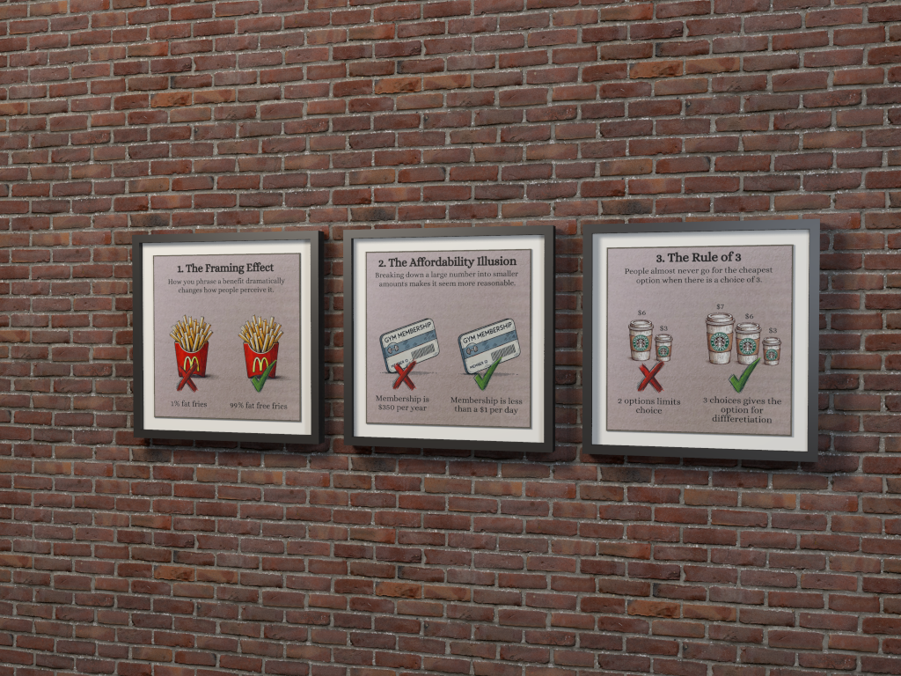
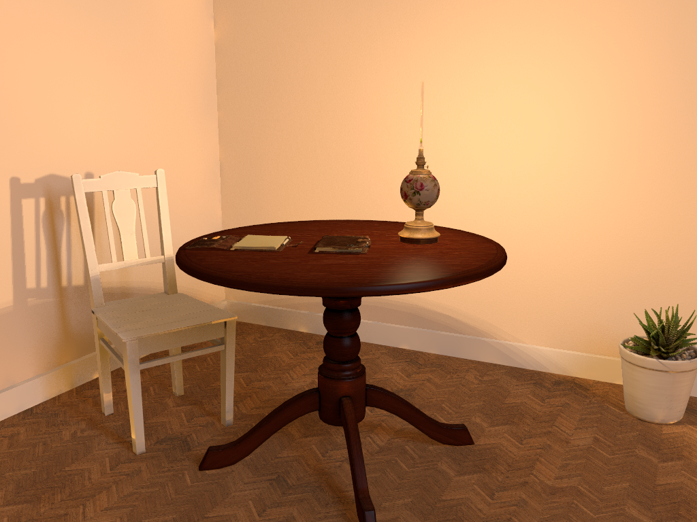

# Image Render

## Purpose

`image-render` ray traces [POV-Ray 3.7](https://www.povray.org/) scene description scripts into PNG
images on cluster nodes. Scenes arrive inline, as a text artifact, or as a packaged example. Images and
include files that a scene references are staged from shared artifact storage into the render sandbox,
and the finished PNG is published as an artifact or returned inline. A renderer is only useful to an
agent that writes valid scene language, so the module also ships a local, searchable copy of the
POV-Ray 3.7 manual, the official example scenes, the standard include files and a starter set of CC0
assets. Any other [Poly Haven](https://polyhaven.com) HDRI, texture or model can be imported on demand.

| Tool | Use |
| --- | --- |
| `render_environment` | POV-Ray version, limits, include search paths, library contents and scene conventions |
| `render_docs` | Search, read, or list sections of the POV-Ray 3.7 manual |
| `render_library` | Search and read example scenes, include files and assets; find predefined identifiers |
| `render_polyhaven` | Search about 2,400 Poly Haven assets, plan their downloads and import them as scene includes |
| `render_check` | Parse a scene with a tiny render and return errors with source context |
| `render_scene` | Render a PNG; optional durable background execution for long renders |
| `render_benchmark` | Run the standard POV-Ray benchmark at the official 512x512 in the background and record it for the dashboard |

## Requirements

| Requirement | Value |
| --- | --- |
| OS | Debian or Ubuntu |
| Architecture | `armhf`, `arm64`, or `amd64` |
| RAM | 900 MB physical |
| Root disk | 768 MB free (POV-Ray, manual, examples, assets, render workspace) |
| Commands | `bash`, `python3`, `bwrap`, `prlimit`, `systemctl`, `apt-get` |
| Network at install | Debian mirror; `dl.polyhaven.org` unless `assets` is `["none"]`; `api.polyhaven.com` for the on-demand index |
| Artifact storage | Optional; required for artifact scenes, `assets[]`, `"artifact:<id>"` references, artifact output and `render_polyhaven` plan and import |
| On-demand assets | `browser-retrieval` installed on a node that can reach `api.polyhaven.com` and `dl.polyhaven.org` |

The installer runs as a durable job. It installs `povray`, `povray-includes` and `fonts-povray`,
extracts the manual and examples from `povray-doc` and `povray-examples` into the module's own library
(so dpkg `path-exclude` rules for `/usr/share/doc` cannot drop them), downloads the selected starter
packs with pinned SHA-256 hashes, converts the starter models, stores the Poly Haven asset index, indexes
everything, and refuses to activate unless a sandboxed smoke render and the sandbox boundary checks pass.

Rendering is CPU-only. POV-Ray uses every core of the node by default, so a render on an amd64 node is
far faster than on a 2-core ARM board. A GPU does not help.

## Quickstart

> Install image-render on cluster5.

> Use image-render to render a glossy red sphere on a checkered floor at 800x600 and save it as an
> artifact.

A typical agent sequence is:

1. `render_environment` for limits and conventions.
2. `render_docs` with `operation: "search"` (for example `"area_light"`), then `read` the best section.
3. `render_library` with `operation: "declarations"` and a query such as `"Jade"` or `"T_Wood"` to find
   ready-made textures, colours and macros, and the include file that defines them.
4. `render_check` until the scene parses without errors.
5. `render_scene`, in the background for large or slow renders.

```json
{
  "scene": {
    "text": "#version 3.7;\nglobal_settings { assumed_gamma 1.0 radiosity { } }\n#include \"vanta_assets.inc\"\ncamera { location <0, 1.2, -3> look_at <0, 0.5, 0> }\nVanta_HDRI_Sky(Vanta_HDRI_Studio_Small_09, 1.0)\nplane { y, 0 texture { T_Vanta_Wood_Table rotate x*90 scale 2 } }\nsphere { <0, 0.6, 0>, 0.6 texture { T_Vanta_Marble } }\n"
  },
  "width": 1280,
  "height": 960,
  "output": { "mode": "artifact", "name": "marble-on-wood.png", "retentionDays": 7 }
}
```

To publish a render to an SMB share, pass `image.artifact.id` to the host's `cluster_export_source`.
To convert or resize it, pass the same ID to `image-processing`.

## Examples

These prompts have been validated end to end. Cross-module workflows require the corresponding
modules and shared artifact storage; share workflows also require a configured read-write SMB source
and an existing destination directory.

### Height Field from a Generated Image

> Use Python on the cluster to generate a 256x256 grayscale PNG of fractal terrain, then render it as a
> POV-Ray height field landscape with water at sea level and the partly cloudy sky HDRI. Save the final
> render as an artifact. Show it inline.

This combines `python-compute` image generation with `image-render`: the generated PNG is passed as an
artifact and used by the scene's `height_field`.

### Check and Repair a Scene

> Here's a POV-Ray scene I wrote. Check it for errors, fix them as needed, and then render it at 640x480:

```pov
camera { location <0,2,-5> look_at <0,1,0> }
light_source { <5,10,-5> colour White }
sphere { <0,1,0>, 1 texture { pigment { color Redd } finish { phong 0.8 } }
plane { y, 0 pigment { checker Black White }
```

The input is intentionally broken: it omits the colour definitions, misspells `Red`, and leaves the
sphere and plane unclosed. The workflow uses `render_check` diagnostics to repair the scene before
calling `render_scene`.

### End to End to the Share

> Render a scene of three colourful glass spheres refracting a checkered background at 1600x1200.
> Convert the result to WebP at quality 85, and export both the PNG and the WebP to my share under
> renders/.

This chains `image-render`, `image-processing` and `cluster_export_source`, keeping both image formats
as artifacts until publication.

### Packaged Example Scenes

> Find three interesting example scenes that ship with the POV-Ray module, ones that show glass,
> isosurfaces or media. Render each at 400x300 and combine them into one side-by-side contact sheet.
> Show the image inline.

Use `render_library` to find the packaged scenes, `render_scene` to render them, and `image-processing`
to assemble the contact sheet from the resulting artifacts.

### Your Own File as an Image Map

> Upload all "Screenshot" images from the vanta share to artifact storage and render them as framed
> pictures hanging on a red brick wall, viewed at a slight angle with soft lighting at 1024x768. Save
> it back to the share.

Discover and import the source images with the host's SMB source tools, stage the artifacts as image
maps in `image-render`, then publish the finished PNG with `cluster_export_source`.

The render produced by this prompt, shown at half size:



### Poly Haven Assets on Demand

> Use image-render to render a cosy evening reading corner at 1024x768. From Poly Haven, import a round
> wooden table, a herringbone parquet floor and a warm interior HDRI, all at 2k. Build a room corner with
> two warm plaster walls and a skirting board, scale the table to a realistic 76 cm height, and put the
> starter oil lamp and binder notebooks on it with the lamp flame as a warm light. Add the starter wooden
> chair and potted plant, and use the HDRI for soft fill light. Save it as an artifact, show it inline,
> and credit Poly Haven.

The agent searches with `render_polyhaven` and picks `round_wooden_table_01`, `herringbone_parquet` and
`lythwood_lounge`. For each one it downloads the file listing and the planned 2k files with
`browser-retrieval` `web_download`, then imports it. That is three downloads for the table, three for
the parquet and one for the HDRI. The table is converted to an 8,640-triangle `mesh2` and scaled from
its imported `PH_Model_round_wooden_table_01_Max.y` to 76 cm. The scene combines the three imported
includes with four starter models. The HDRI, hidden by the walls, adds warm fill through radiosity. A
fading point light at the lamp's flame provides the glow; the lamp is marked `no_shadow` so its own
glass and brass do not cast a pattern onto the wall. cluster5 rendered it in about 30 seconds.

The render produced by this prompt, shown at half size. Powered by Poly Haven:




## Tools

### `render_environment`

Reports the installed POV-Ray package version, the asset selection, library counts, include search
paths, every limit, whether shared artifacts are available, the verified isolation, and the scene
conventions described under [Scenes, Files and Artifacts](#scenes-files-and-artifacts).

### `render_docs`

The Debian `povray-doc` HTML manual is split into its numbered sections (about 800): user guide `1.x`,
tutorial `2.x`, and reference `3.x`.

| Operation | Arguments | Result |
| --- | --- | --- |
| `search` | `query`, `limit` (1-20) | BM25-ranked sections with breadcrumb path and snippet; title matches are boosted |
| `read` | `sectionId` such as `3.4.2.1.1`, `offset`, `maxCharacters` (500-40000) | Section text with preserved code blocks, subsections, and the online URL |
| `toc` | optional `sectionId`, `depth` (1-4) | Section titles below a section, or the top level |

Keywords keep their underscores, so `look_at`, `image_map` and `area_light` match exactly.

### `render_library`

| Operation | Arguments | Result |
| --- | --- | --- |
| `search` | `query`, optional `kind` (`example`, `include`, `asset`), `limit` (1-30) | Matching example scenes (about 1,300 files), include files, and assets |
| `read` | `path` such as `examples/advanced/teapot/teapot.pov` or `include/woods.inc`, `offset`, `maxCharacters` (500-40000) | Text with `offset` paging; binary assets report their size and how to reference them |
| `declarations` | optional `query`, optional `path` of an include file, `limit` (1-200) | `#declare` and `#macro` identifiers with type, signature, comment, line and include file |

Paths start with `examples/`, `include/` (the standard POV-Ray include directory) or `assets/`.
Declarations are indexed for the standard include files and `assets/vanta_assets.inc` only; any other
`path` is rejected.
An example scene can be rendered directly with `scene: {"example": "advanced/teapot/teapot.pov"}`;
its own directory is then added to the library path so its local include and image files resolve.

### `render_polyhaven`

| Operation | Arguments | Result |
| --- | --- | --- |
| `search` | optional `query`, `kind` (`hdri`, `texture`, `model`), `limit` (1-30) | Assets ranked by matched words, then downloads, with `assetId`, category, tags, model polycount, size and materials, and `filesUrl` |
| `plan` | `assetId`, `resolution` (`1k`, `2k`), `filesArtifactId` | `downloads[]` with name, role, size, whether required, and a ready `webDownload` argument object |
| `import` | the `plan` arguments, `files` (up to 16 `{name, artifactId}`), `retentionDays` | The published include, the `assets[]` for `render_scene`, `sceneInclude`, declared identifiers, usage, and for models triangles and size |

The workflow, limits and naming are described under
[On-Demand Poly Haven Assets](#on-demand-poly-haven-assets). Search needs no artifact storage; plan and
import do. Imports share one slot per node and count against `callsPerMinute`.

### `render_check`

Accepts the same `scene`, `files`, `assets`, `declares` and `clock` as `render_scene`, renders 32x24
at quality 0 without writing an image, and returns `ok`, `exitReason`, `diagnostics`, `statistics`,
`durationMs`, `threads` and the staged `inputs`. On failure it also returns `returnCode`, the last 40
console lines as `log`, and `logTruncated`. Each diagnostic has `severity`, `kind` (`Parse Error`, `Possible Parse Error`,
`Parse Warning`, `Fatal`, ...), `message`, and where POV-Ray reports one, `file`, `line` and `context`:
the surrounding source lines of the inline scene or file with the failing line marked.

```json
{
  "severity": "error",
  "kind": "Parse Error",
  "message": "Expected 'object or directive', undeclared identifier 'spher' found instead",
  "file": "scene.pov",
  "line": 4,
  "context": [
    { "line": 3, "text": "camera { location <0,1,-3> look_at 0 }", "error": false },
    { "line": 4, "text": "spher { 0, 1 }", "error": true }
  ]
}
```

Checks use their own slot, so they are not blocked by a long render on the same node.

### `render_scene`

| Argument | Default | Notes |
| --- | --- | --- |
| `scene` | required | `{text, name?}`, `{artifactId, name?}`, or `{example}` |
| `files` | `[]` | Up to 16 inline text files (2,000,000 characters total) written beside the scene |
| `assets` | `[]` | Up to 32 artifacts staged read-only as `/inputs/<name>` |
| `declares` | `{}` | Up to 32 numeric identifiers, like `Declare=Name=Value` |
| `clock` | unset | Value of `clock`, for one animation frame |
| `width`, `height` | 800, 600 | Up to 8192 each and 16,777,216 pixels |
| `quality` | 9 | POV-Ray `+Q` 0-11 |
| `antialias` | enabled, threshold 0.3, method 1, depth 3 | `+A`, `+AM`, `+R` |
| `alpha` | false | Transparent background in the PNG alpha channel |
| `bitDepth` | 8 | 8 or 16 bits per channel |
| `output` | `{"mode": "artifact"}` | Artifact (`name`, `retentionDays` 1-90) or inline base64 up to 2,000,000 bytes |
| `timeoutMs` | 5 minutes | Up to the node's immediate limit, or its background limit in a background job |

The result reports `ok`, `exitReason` (`completed`, `error`, `timeout`, `killed`, `disconnected`,
`workspace`), `diagnostics`, `statistics` (parse, bounding, photon, radiosity and trace seconds),
`durationMs`, `threads`, the staged `inputs`, and on success `image` with its width, height, bit depth,
byte size and either base64 data or the published artifact. A failed render is returned as an error
result with the same diagnostics, so the agent can correct the scene.

#### Background renders

`render_scene` is declared `optional` for background execution:

> Render this scene at 3840x2160 in the background and tell me when it is done.

`cluster_call_module_tool` with `execution: "background"` returns a `jobId`; poll `cluster_get_job` and
read the result with `includeResult: true`. The default and maximum background limit is the
`maxBackgroundTimeoutMs` install option (4 hours unless configured, at most 24 hours). Cancelling the job
closes the broker connection, and the broker stops the render within about a second.

### `render_benchmark`

> Benchmark image-render on cluster3 and cluster5.

Renders the packaged official benchmark scene, `examples/advanced/benchmark/benchmark.pov` (scene
version 2.01), with exactly the INI options listed in that file's header, stored as
[benchmark.ini](benchmark.ini), including the official 512x512 resolution. The only deviations are that
the scene is passed on the command line and the empty shell-out hooks are omitted. No image is written
(`Output_To_File=Off`), and POV-Ray uses every render thread of the installation. The tool takes no
arguments, is background-only, uses the node's render slot, and has a fixed 24-hour limit independent
of `maxBackgroundTimeoutMs`, because small ARM boards need hours.

The result reports the scene SHA-256 and version, threads, parse, photon and trace seconds, total
duration and traced pixels per second. A successful run also replaces the installation report at
`/var/lib/vantamcpd/module-reports/image-render/report.json`. VantaMCPd reads that file with the module
receipts, so the summary appears in the dashboard's module dialog under **Installations** and as
`nodes[].report` in `cluster_list_modules`; `render_environment` returns the full details. The report
survives module updates and is removed by uninstall.

Results of `render_benchmark` (image-render 0.2.1, Debian POV-Ray 3.7.0.10, official 512x512) on
2026-10-23:

| Node | CPU | Threads | Parse | Photons | Trace | Total | Traced pixels/s |
| --- | --- | --- | --- | --- | --- | --- | --- |
| cluster5 | x86-64 QEMU VM, 4 cores | 4 | 0.4 s | 1.6 s | 219.0 s | 221.9 s (3 min 42 s) | 1,196.8 |
| cluster3 | Allwinner A20, 2x ARMv7 at 960 MHz | 2 | 5.4 s | 25.8 s | 9,231.3 s | 9,263.8 s (2 h 34 min) | 28.4 |

cluster3 took about 42 times as long as cluster5 overall, and its trace phase was 42 times slower per
pixel. Scene parsing was 14 times slower and the photon pass 16 times slower. A preliminary
`render_scene` run of the same scene at 200x150 without the benchmark's jitter showed the same ratio
(35.6 s against 1,447.8 s), so a small preview render is a reliable way to estimate a long render on
another node. Both runs used scene SHA-256 `06c9c8d9...c1ec3643`.

## Scenes, Files and Artifacts

Inside the sandbox the scene is `/work/<scene name>` and the working directory is `/work`. POV-Ray's
library path is, in order: `/work`, `/inputs`, the standard include directory,
`/vanta-library/assets` and its pack directories, and for example scenes the example's directory. Any
file on that path is referenced by bare name.

| Content | How to supply it | Scene reference |
| --- | --- | --- |
| Extra include or data file | `files: [{"name": "parts.inc", "text": "..."}]` | `#include "parts.inc"` |
| Named artifact | `assets: [{"artifactId": "<id>", "name": "photo.png"}]` | `png "photo.png"` |
| Inline artifact reference | the string literal `"artifact:<32-hex id>"` anywhere in the scene or files | replaced by `"/inputs/<id8>-<stored name>"` |
| Scene stored as an artifact | `scene: {"artifactId": "<id>"}` | its references are resolved the same way |
| Standard include | nothing | `#include "woods.inc"` |
| CC0 assets | nothing | `#include "vanta_assets.inc"` or a file name such as `jpeg "marble_01_diff_1k.jpg"` |

For example, `height_field { png "artifact:0123...cdef" }` stages that artifact and rewrites the literal
before POV-Ray parses the scene. Only complete string literals are rewritten, so the same text inside a
longer string is left alone. Each artifact is integrity-checked against its SHA-256 and copied into the
call's private input directory; the shared artifact store itself is never mounted into the sandbox.
Names ending in `.ini`, `.conf` or `.pov-state`, and the reserved output name `render.png`, are rejected
for `files` and `assets`. A referenced artifact whose stored name has one of those suffixes is staged
with `.txt` appended, so a staged file can never stand in for POV-Ray configuration. An artifact listed
in `assets` and also referenced as `"artifact:<id>"` is staged once, under its `assets` name.

## Asset Library

### Starter Set

The installer fetches a small CC0 1.0 starter set from [Poly Haven](https://polyhaven.com) with pinned
sizes and SHA-256 hashes from [assets.json](assets.json), so common scenes work offline and the install
smoke test has something to render. A file that fails to download or verify is skipped and reported in
`render_environment`; it is never installed. On update, files already present in the previous version
are reused when their hashes match. Everything lives in `vanta_assets.inc` and the pack directories,
which are on the library path.

| Pack | Files | Use |
| --- | --- | --- |
| `hdri` | 4 equirectangular 1k Radiance HDR environments: two studios, a daylight sky, a sunset | `Vanta_HDRI_Sky(Vanta_HDRI_<Name>, Intensity)` returns a `sky_sphere`; with `radiosity` it also lights the scene. `Vanta_HDRI_Sky_Rotated(Name, Intensity, Degrees)` turns it |
| `textures` | 9 seamless 1k materials: wood table, plank floor, red brick, concrete, rock, marble, metal plate, rusty metal, grass and rock. Each has a colour, displacement and roughness map | `T_Vanta_<Name>` with bump relief from the displacement map and gloss varying with the roughness map; `T_Vanta_<Name>_Simple` is colour only and faster; `P_Vanta_<Name>` and `N_Vanta_<Name>` are the pigment and normal. All span the unit square in the x-y plane; rotate `x*90` for floors |
| `models` | 6 photoscanned props converted from glTF to `mesh2` at installation: ceramic vase, painted wooden chair, potted succulent, binder notebooks, vintage oil lamp, wooden crate | `#include "vanta_model_<name>.inc"` then `object { Vanta_Model_<Name> }`. Metres, standing on y=0, centred on x and z, front facing -z; `Vanta_Model_<Name>_Min` and `_Max` are the bounds |

`render_library` with `operation: "declarations"` and `query: "Vanta"` lists every generated
identifier. POV-Ray 3.7 cannot apply tangent-space normal maps or per-pixel metalness to a mesh, so
models use only their colour (and emission) maps; the oil lamp's glass is transparent and its flame
glows.

### On-Demand Poly Haven Assets

The installer also stores the public Poly Haven asset list (about 2,400 HDRIs, textures and models)
as `library/polyhaven.json`. `render_polyhaven` searches it and imports any asset at 1k or 2k. The
broker itself stays network-free: files are downloaded by `browser-retrieval`'s `web_download` into
shared artifact storage.

1. `render_polyhaven` `search` with `query` and optional `kind` (`hdri`, `texture`, `model`). Each
   result has an `assetId` and a `filesUrl`.
2. `browser-retrieval` `web_download` of the `filesUrl`, named `<assetId>.files.json`.
3. `render_polyhaven` `plan` with `assetId`, `resolution` (`1k` default, or `2k`) and that listing's
   `filesArtifactId`. It returns one ready `webDownload` argument object per file: the colour,
   displacement and roughness maps for a texture; the `.hdr` for an HDRI; the glTF, its buffer and its
   colour maps for a model.
4. `web_download` each planned file.
5. `render_polyhaven` `import` with the same arguments plus `files: [{name, artifactId}]`. It checks
   every file's size and MD5 against the listing, builds `ph_<assetId>_<resolution>.inc` (converting
   models to `mesh2`) and publishes it. The result's `assets` array goes into `render_scene` unchanged,
   and `sceneInclude` into the scene.

Imported identifiers mirror the starter set with a `PH` prefix: `T_PH_<id>`, `T_PH_<id>_Simple`,
`P_PH_<id>`, `N_PH_<id>`, `PH_HDRI_<id>` with the `PH_HDRI_Sky` macros, and `PH_Model_<id>` with its
`_Min` and `_Max` bounds. IDs longer than 26 characters are shortened with a hash suffix; the import
result lists the exact names. Models are limited to 60,000 polygons, one file to 50 MiB and one asset to
160 MB. A model whose Poly Haven materials are all metals gets a metallic finish.

Poly Haven's [API terms](https://polyhaven.com/our-api) ask integrations to credit Poly Haven, so every
`render_polyhaven` result carries a `credit` line: show it to the user alongside renders that use the
asset. The index is refreshed on reinstall; without it, `render_polyhaven` reports that it is
unavailable and the starter set still works.

## Installation Options

| Option | Default | Range | Effect |
| --- | --- | --- | --- |
| `assets` | `["hdri", "textures", "models"]` | any of `hdri`, `textures`, `models`, or `["none"]` alone | Starter packs downloaded at installation |
| `maxMemoryMb` | 75% of RAM / renders | 256-16384 | Address-space limit of one render |
| `threads` | CPU cores | 1-64 | POV-Ray `+WT` per render |
| `maxTimeoutMs` | 600000 | 10000-1800000 | Highest immediate render limit |
| `maxBackgroundTimeoutMs` | 14400000 | 60000-86400000 | Highest and default background render limit |
| `concurrentRenders` | 1 | 1-4 | Renders at once, immediate and background combined |
| `callsPerMinute` | 20 | 1-120 | Render and check calls accepted per minute |

The service cgroup is sized from the node: `MemoryHigh` 75% and `MemoryMax` 85% of RAM, `CPUQuota` of
all cores, low `CPUWeight` and `Nice=10`, so renders yield to other services.

## Security Model

- The broker is a systemd service under the unprivileged `vantamcpd-render` account with an empty
  capability set, `NoNewPrivileges`, `ProtectSystem=strict`, `ProtectHome` and `PrivateTmp`. Only the
  configured SSH user's UID may use its socket (`SO_PEERCRED`).
- Each check and render runs `/usr/bin/povray` under bubblewrap with new user, mount, PID, IPC, UTS,
  cgroup and network namespaces and no network. The mount namespace is the file boundary: `/usr`, `/lib`
  and the dynamic-loader files are read-only, `/etc` and home directories are absent, `/inputs` and
  `/vanta-library` are read-only, and only the per-call `/work` and `/tmp` are writable. Both live on
  disk under the call directory and are deleted afterwards.
- `prlimit` caps address space, CPU seconds (scaled by thread count), file size, open files and
  processes and disables core dumps. The broker stops a render on its wall-clock limit, when the caller
  disconnects, or when `/work` and `/tmp` together exceed the scratch budget or 2,000 files. The scratch
  budget, which is also the per-file size limit, is the PNG output budget plus POV-Ray's 20-byte-per-pixel
  image buffer plus 64 MiB. POV-Ray moves that buffer into a `/tmp` file once it exceeds 128 MB, about
  6.7 megapixels, so a 16-megapixel render needs about 450 MiB of free disk under
  `/var/lib/vantamcpd-render`.
- POV-Ray's console output is drained continuously and only its first 16 KiB and last 64 KiB are kept,
  so `#debug` loops cannot exhaust broker memory.
- The broker builds the POV-Ray command line itself; callers cannot pass INI files or options.
  `POVINI` points at a fixed read-only INI file and shell-out commands are never configured.
- A restricted `povray.conf` (read the library path, write only `/work`, shell-out forbidden) is
  mounted over both the system and user policy locations. During validation, Debian's POV-Ray
  3.7.0.10 accepted this policy but did not enforce it for scene file access: `#fopen` and `#include`
  of `/usr/lib/os-release` and writes to `/var/tmp` succeeded outside a sandbox. The policy is therefore
  kept only as defense in depth, and the installer's smoke test verifies the mount boundary instead:
  reading `/etc/passwd`, writing to `/usr`, `/inputs` or `/vanta-library` must fail, and a write to
  `/tmp` must not reach the host.
- Scene text is never logged; the broker logs a SHA-256 prefix, size and dimensions.
- The broker and the render sandbox have no network access (`RestrictAddressFamilies=AF_UNIX AF_NETLINK`).
  On-demand Poly Haven files arrive only as artifacts downloaded by `browser-retrieval`. `plan` accepts
  only `https://dl.polyhaven.org` URLs from the listing, and `import` rejects any file whose size or
  MD5 differs from it. The glTF converter is pure Python with no code execution, bounded by file and
  polygon limits.

Scenes are untrusted input to a trusted renderer. The sandbox limits what a malicious scene can read,
write or consume. It is not a boundary against a kernel or bubblewrap vulnerability.

## Data Lifecycle

Per-call directories under `/var/lib/vantamcpd-render/calls` are deleted after every call and purged
when the broker starts. Rendered PNGs and imported Poly Haven includes persist only as artifacts, until
their retention expires; re-import an asset when its artifacts have expired. The
manual, examples and assets live in the versioned install directory and are removed by uninstall, which
also removes the service account, environment file, systemd drop-in and state directory. The `povray`
packages remain installed.

## Troubleshooting

| Symptom | Cause and fix |
| --- | --- |
| `Possible Parse Error: assumed_gamma not specified` | A warning, not a failure; add `global_settings { assumed_gamma 1.0 }` |
| `Cannot open include file` | The file is not on the library path; add it to `files`, `assets`, or check the name with `render_library` |
| `exitReason: "timeout"` | Lower `quality`, `antialias` or size, or submit with `execution: "background"` |
| `exitReason: "killed"` | A memory, CPU or file-size limit stopped POV-Ray; `log` names the signal. Reduce resolution, photons, radiosity or mesh size |
| `exitReason: "workspace"` | The scene wrote too much with `#write`; write less or nothing |
| `already running ... render(s)` | Another render holds the slot; retry, target another node, or install with more `concurrentRenders` |
| `shared artifact storage is unavailable` | Artifact storage is not configured for this node; use inline scenes, `files` and inline output |
| Missing asset packs in `render_environment` | A download failed at install time; reinstall when `dl.polyhaven.org` is reachable |
| `browser retrieval queue is full` | Too many `web_download` calls were sent at once; send them one or two at a time |
| `the Poly Haven index is not installed` | `api.polyhaven.com` was unreachable at install time; reinstall to fetch it |
| `does not match the Poly Haven listing` | A download is truncated or not the planned file; run `web_download` again with `reuse: false` |
| `files not in the plan` | A file name differs from the plan's `name`, or it belongs to another resolution |
| `is not a Poly Haven file listing` | `filesArtifactId` is not the JSON from `filesUrl`; download it again |

## Licensing

| Content | Licence |
| --- | --- |
| POV-Ray program and manual | AGPL-3.0+ (Debian `povray`, `povray-doc`) |
| Example scenes | CC BY 3.0 |
| Standard include files | CC BY-SA 3.0 |
| Poly Haven assets | CC0 1.0; the live API asks for a "Powered by Poly Haven" credit |

The Debian copyright file is installed as `library/COPYRIGHT`. Renders are the caller's own output.

## Future Work

- Parallax-correct displacement for close-up textures, and per-pixel metalness by blending finishes with
  a model's metal map through `uv_mapping` `image_pattern`.
